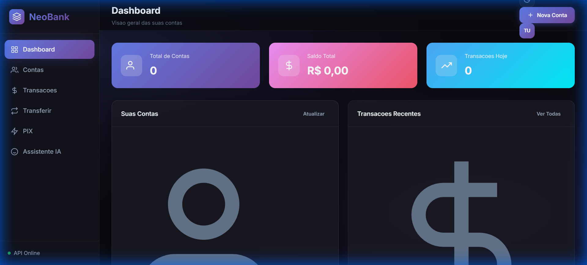
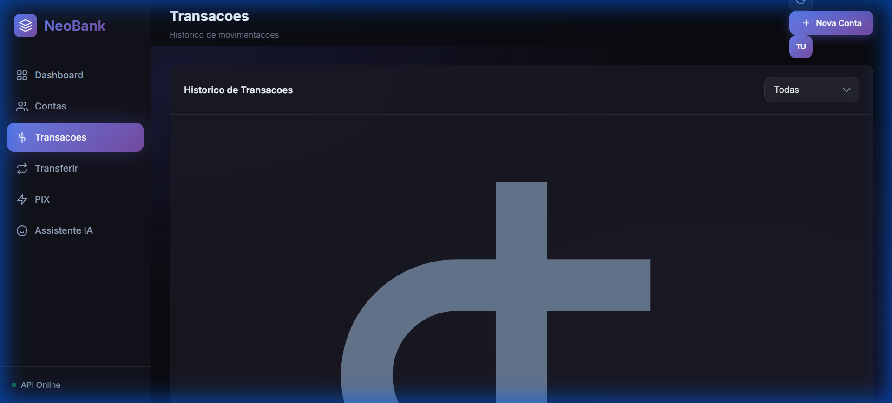
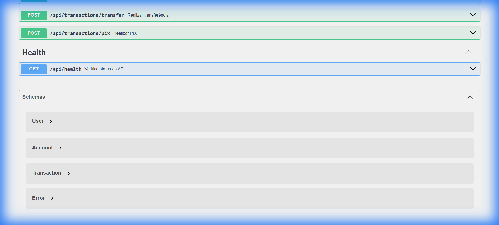

# NeoBank API

[](https://github.com/ArthurDays/banking-api/actions/workflows/ci.yml)
[](https://nodejs.org/)

Aplicação bancária full-stack construída para demonstrar engenharia de APIs, autenticação, segurança, testes e entrega em contêiner. Inclui gestão de contas, depósitos, saques, transferências, PIX, atualização em tempo real e um assistente opcional com Gemini.

> Projeto educacional. Não utilize para armazenar dinheiro real ou dados financeiros de produção.

## Destaques de engenharia

- Autenticação JWT com access e refresh tokens.
- Senhas protegidas com bcrypt e controles contra força bruta.
- Helmet, CORS, rate limiting, validação e sanitização de entradas.
- Operações com UUID e persistência SQLite via `sql.js`.
- Swagger/OpenAPI em `/api/docs` e atualizações via WebSocket.
- Testes com Jest e Supertest, CI no GitHub Actions e execução com Docker.
- Assistente com Gemini, habilitado quando `GEMINI_API_KEY` está configurada.

## Arquitetura

```text
Browser / API client
        │
        ▼
Express API ── security middleware ── JWT authentication
    │               │                       │
    ├── accounts    ├── validation          ├── access token
    ├── transactions├── rate limiting       └── refresh token
    ├── assistant   └── error handling
    ├── SQLite (sql.js)
    └── WebSocket updates
```

## Execução local

Requer Node.js 20+ e npm.

```bash
git clone https://github.com/ArthurDays/banking-api.git
cd banking-api
npm install
npm run dev
```

Defina segredos próprios antes de executar fora de um ambiente local:

```bash
JWT_SECRET=troque-este-valor
REFRESH_SECRET=troque-este-valor
GEMINI_API_KEY=opcional
ALLOWED_ORIGINS=http://localhost:3000
```

Comandos disponíveis:

```bash
npm start
npm test
npm run test:coverage
docker compose up --build
```

- Aplicação: `http://localhost:3000`
- API: `http://localhost:3000/api`
- Swagger: `http://localhost:3000/api/docs`
- Health check: `http://localhost:3000/api/health`

## Principais endpoints

| Área | Método | Endpoint | Descrição |
| --- | --- | --- | --- |
| Auth | `POST` | `/api/auth/register` | Cria usuário |
| Auth | `POST` | `/api/auth/login` | Emite access e refresh tokens |
| Auth | `POST` | `/api/auth/refresh` | Renova o access token |
| Contas | `GET/POST` | `/api/accounts` | Lista ou cria contas |
| Contas | `GET/PUT/DELETE` | `/api/accounts/:id` | Consulta, altera ou desativa conta |
| Transações | `POST` | `/api/transactions/deposit` | Realiza depósito |
| Transações | `POST` | `/api/transactions/withdraw` | Realiza saque |
| Transações | `POST` | `/api/transactions/transfer` | Transfere entre contas |
| Transações | `POST` | `/api/transactions/pix` | Realiza PIX |

A especificação completa e os schemas ficam disponíveis no Swagger.

## Interface

| Dashboard | Transações | API Docs |
| --- | --- | --- |
|  |  |  |

## Estrutura

```text
src/
├── index.js
├── database.js
├── swagger.js
├── middleware/security.js
└── routes/
    ├── auth.js
    ├── accounts.js
    ├── transactions.js
    └── assistant.js
public/                   # cliente web
tests/                    # testes de API
docs/screenshots/         # evidências visuais
.github/workflows/        # integração contínua
```

## Segurança e limitações

Os segredos padrão facilitam apenas a demonstração local. Em implantação, forneça `JWT_SECRET` e `REFRESH_SECRET` fortes, limite `ALLOWED_ORIGINS` e use HTTPS. Esta aplicação não substitui uma infraestrutura financeira auditada.

## Licença

MIT.
